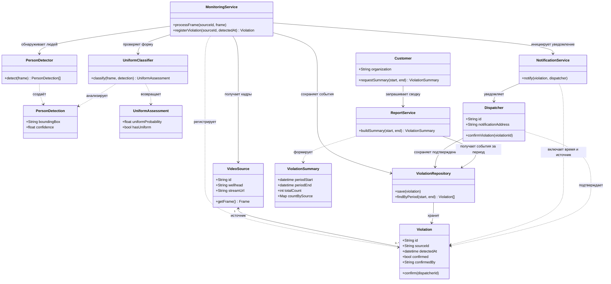

# Диаграммы

## Диаграмма последовательности

`````mermaid
sequenceDiagram

	participant input as Видеопоток

	participant system as Сервис

	participant YOLO as CNN-Детектор

	participant EffNet as CNN-Классификатор

	actor User as Диспетчер

	input->>system: Трансляция с устья

	system->>YOLO: Запуск детекции на кадре

	YOLO->>EffNet: Изображения людей в кадре

	EffNet-->>system: Вероятности ношения формы

	system->>User: Наличие людей без формы на устье
`````


## Диаграмма классов


